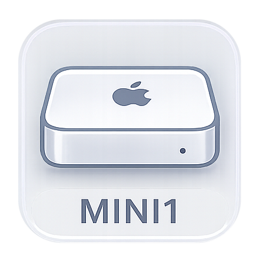
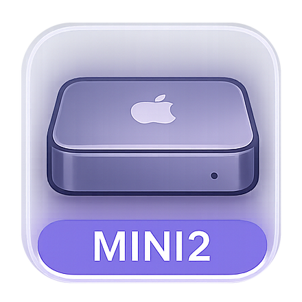
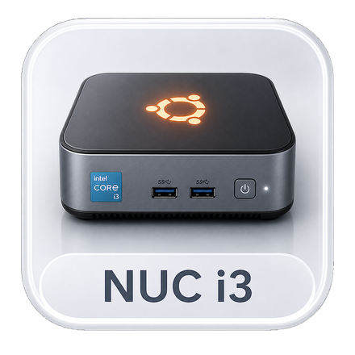
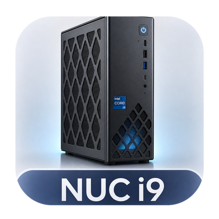
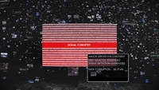

# Icon 资源库

这是一个用于存放项目图标（Icon）、相关图片资源及 Clash 规则集的仓库。

## 图标与图片资源

以下是当前仓库中存放的图标与图片资源：

### 根目录图标与图片

| 图标文件 | 预览 | 在线直链 | 说明 |
| :--- | :---: | :--- | :--- |
| `air_icon.png` |  | `https://raw.githubusercontent.com/NathanDai/Icon/main/air_icon.png` | MacBook Air (m1) 图标 |
| `mini1_icon.png` |  | `https://raw.githubusercontent.com/NathanDai/Icon/main/mini1_icon.png` | Mac Mini (m1) 图标 |
| `mini2_icon.png` |  | `https://raw.githubusercontent.com/NathanDai/Icon/main/mini2_icon.png` | Mac Mini (m2) 图标 |
| `nuc_icon.png` |  | `https://raw.githubusercontent.com/NathanDai/Icon/main/nuc_icon.png` | NUC i3 Ubuntu 小主机图标 |
| `nuc_i9_icon.png` |  | `https://raw.githubusercontent.com/NathanDai/Icon/main/nuc_i9_icon.png` | NUC i9 Extreme 小主机图标 |
| `finch1_icon.png` |  | `https://raw.githubusercontent.com/NathanDai/Icon/main/finch1_icon.png` | Finch 头像 1 |
| `finch2_icon.png` |  | `https://raw.githubusercontent.com/NathanDai/Icon/main/finch2_icon.png` | Finch 头像 2 |
| `finch1_avatar.png` |  | `https://raw.githubusercontent.com/NathanDai/Icon/main/finch1_avatar.png` | Finch 头像 1（avatar 版本） |
| `finch2_avatar.png` |  | `https://raw.githubusercontent.com/NathanDai/Icon/main/finch2_avatar.png` | Finch 头像 2（avatar 版本） |
| `finch2_avatar_refined.png` |  | `https://raw.githubusercontent.com/NathanDai/Icon/main/finch2_avatar_refined.png` | Finch 头像 2（refined 版本） |
| `vlcsnap.png` |  | `https://raw.githubusercontent.com/NathanDai/Icon/main/vlcsnap.png` | 图片资源（200×113） |

### Quantumult 图标

存放于 `quantumult/`，统一使用 144×144、带 Alpha 通道的 PNG。

| 图标文件 | 预览 | 在线直链 | 说明 |
| :--- | :---: | :--- | :--- |
| `quantumult/anthropic.png` |  | `https://raw.githubusercontent.com/NathanDai/Icon/main/quantumult/anthropic.png` | Anthropic 图标 |
| `quantumult/openai.png` |  | `https://raw.githubusercontent.com/NathanDai/Icon/main/quantumult/openai.png` | OpenAI 图标 |
| `quantumult/domestic.png` |  | `https://raw.githubusercontent.com/NathanDai/Icon/main/quantumult/domestic.png` | Domestic 图标 |
| `quantumult/asiantv.png` |  | `https://raw.githubusercontent.com/NathanDai/Icon/main/quantumult/asiantv.png` | AsianTV 图标 |
| `quantumult/global.png` |  | `https://raw.githubusercontent.com/NathanDai/Icon/main/quantumult/global.png` | Global 图标 |
| `quantumult/globaltv.png` |  | `https://raw.githubusercontent.com/NathanDai/Icon/main/quantumult/globaltv.png` | GlobalTV 图标 |
| `quantumult/final.png` |  | `https://raw.githubusercontent.com/NathanDai/Icon/main/quantumult/final.png` | Final 图标 |
| `quantumult/home2.png` |  | `https://raw.githubusercontent.com/NathanDai/Icon/main/quantumult/home2.png` | HOME2 回家图标 |
| `quantumult/home3.png` |  | `https://raw.githubusercontent.com/NathanDai/Icon/main/quantumult/home3.png` | HOME3 回家图标 |
| `quantumult/home4.png` |  | `https://raw.githubusercontent.com/NathanDai/Icon/main/quantumult/home4.png` | HOME4 回家图标 |

## Clash 规则文件

在 [`clash/`](clash/README.md) 目录下存放 Clash (Rule-Provider) 规则文件。

| 规则文件 | 说明 | 在线直链 |
| :--- | :--- | :--- |
| `clash/rules.yaml` | 自定义规则集模板，当前未包含有效规则 | `https://raw.githubusercontent.com/NathanDai/Icon/main/clash/rules.yaml` |
| `clash/igpandi.yaml` | IGPANDI、P&I 俱乐部及相关网站规则集 | `https://raw.githubusercontent.com/NathanDai/Icon/main/clash/igpandi.yaml` |
| `clash/owndirect.yaml` | 自用直连规则集，包含域名及 IP 精确匹配规则 | `https://raw.githubusercontent.com/NathanDai/Icon/main/clash/owndirect.yaml` |
| `clash/zai.yaml` | 智谱 / Z.ai 相关域名规则集 | `https://raw.githubusercontent.com/NathanDai/Icon/main/clash/zai.yaml` |

规则集使用 `behavior: classical`，实际分流策略由主配置的 `RULE-SET` 引用指定；使用 `owndirect.yaml` 实现直连时，应指定 `DIRECT`。

## 使用说明

1. **新增图标**：通用图标与图片放在根目录，Quantumult 专用图标放在 `quantumult/`；新增后更新本文件中对应的列表、预览及在线直链。
2. **Quantumult 规格**：优先使用 SVG 等矢量源渲染为 144×144、带 Alpha 通道的 PNG，避免放大小尺寸位图；具体流程见[图标资源技能说明](skills/quantumult-icon-assets/SKILL.md)。
3. **Clash 规则**：在 `clash/` 目录下添加 YAML 格式规则文件，通过主配置的 `rule-providers` 和 `RULE-SET` 引用；配置示例见 [Clash 使用说明](clash/README.md)。
4. **命名规范**：使用小写字母、数字、连字符或下划线，例如 `custom-icon.png` 或 `custom_rules.yaml`。
5. **在线直链**：表格中的 Raw URL 指向 GitHub `main` 分支；新增或修改的资源需推送到该分支后，远程引用才能获取更新。

