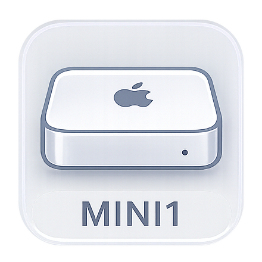
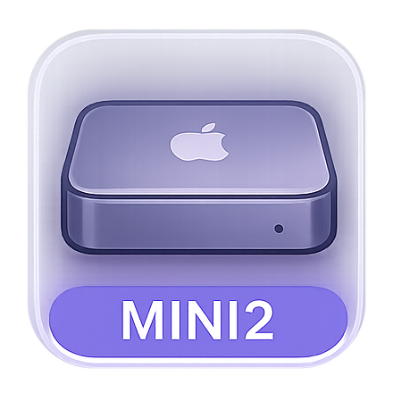
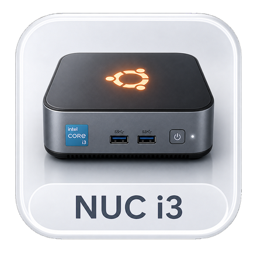
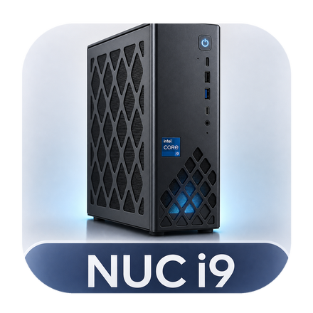

# Icon 资源库

这是一个用于存放项目图标（Icon）及相关图片资源的仓库。

## 包含的图标文件

以下是当前仓库中存放的图标文件：

| 图标文件 | 预览 | 在线直链 | 说明 |
| :--- | :---: | :--- | :--- |
| `air_icon.png` |  | `https://raw.githubusercontent.com/NathanDai/Icon/main/air_icon.png` | MacBook Air (m1) 图标 |
| `mini1_icon.png` |  | `https://raw.githubusercontent.com/NathanDai/Icon/main/mini1_icon.png` | Mac Mini (m1) 图标 |
| `mini2_icon.png` |  | `https://raw.githubusercontent.com/NathanDai/Icon/main/mini2_icon.png` | Mac Mini (m2) 图标 |
| `nuc_icon.png` |  | `https://raw.githubusercontent.com/NathanDai/Icon/main/nuc_icon.png` | NUC i3 Ubuntu 小主机图标 |
| `nuc_i9_icon.png` |  | `https://raw.githubusercontent.com/NathanDai/Icon/main/nuc_i9_icon.png` | NUC i9 Extreme 小主机图标 |
| `finch1_icon.png` |  | `https://raw.githubusercontent.com/NathanDai/Icon/main/finch1_icon.png` | Finch 头像 1 |
| `finch2_icon.png` |  | `https://raw.githubusercontent.com/NathanDai/Icon/main/finch2_icon.png` | Finch 头像 2 |
| `quantumult/anthropic.png` |  | `https://raw.githubusercontent.com/NathanDai/Icon/main/quantumult/anthropic.png` | Anthropic 图标 |
| `quantumult/openai.png` |  | `https://raw.githubusercontent.com/NathanDai/Icon/main/quantumult/openai.png` | OpenAI 图标 |
| `quantumult/domestic.png` |  | `https://raw.githubusercontent.com/NathanDai/Icon/main/quantumult/domestic.png` | Domestic 图标 |
| `quantumult/asiantv.png` |  | `https://raw.githubusercontent.com/NathanDai/Icon/main/quantumult/asiantv.png` | AsianTV 图标 |
| `quantumult/global.png` |  | `https://raw.githubusercontent.com/NathanDai/Icon/main/quantumult/global.png` | Global 图标 |
| `quantumult/globaltv.png` |  | `https://raw.githubusercontent.com/NathanDai/Icon/main/quantumult/globaltv.png` | GlobalTV 图标 |
| `quantumult/final.png` |  | `https://raw.githubusercontent.com/NathanDai/Icon/main/quantumult/final.png` | Final 图标 |
| `quantumult/home2.png` |  | `https://raw.githubusercontent.com/NathanDai/Icon/main/quantumult/home2.png` | HOME2 回家图标 |
| `quantumult/home3.png` |  | `https://raw.githubusercontent.com/NathanDai/Icon/main/quantumult/home3.png` | HOME3 回家图标 |
| `quantumult/home4.png` |  | `https://raw.githubusercontent.com/NathanDai/Icon/main/quantumult/home4.png` | HOME4 回家图标 |

## Clash 规则文件

在 [`clash/`](clash/README.md) 目录下存放 Clash (Rule-Provider) 规则文件。

| 规则文件 | 说明 | 在线直链 |
| :--- | :--- | :--- |
| `clash/rules.yaml` | Clash 自定义规则集样例 | `https://raw.githubusercontent.com/NathanDai/Icon/main/clash/rules.yaml` |
| `clash/igpandi.yaml` | IGPANDI & P&I 俱乐部与 CDN 相关规则集 | `https://raw.githubusercontent.com/NathanDai/Icon/main/clash/igpandi.yaml` |

## 使用说明

1. **新增图标**：将新图标文件放入本目录后，建议在此 `README.md` 中更新列表及预览。
2. **Clash 规则**：在 `clash/` 目录下添加 YAML 格式规则文件，可在 Clash 配置中以 `rule-providers` 方式进行引用。
3. **命名规范**：推荐使用小写字母、数字和下划线组合，例如 `custom_icon.png` 或 `custom_rules.yaml`。
4. **格式建议**：图标优先使用 `PNG`（透明背景）或 `SVG` 格式；规则使用 `YAML` 格式。

